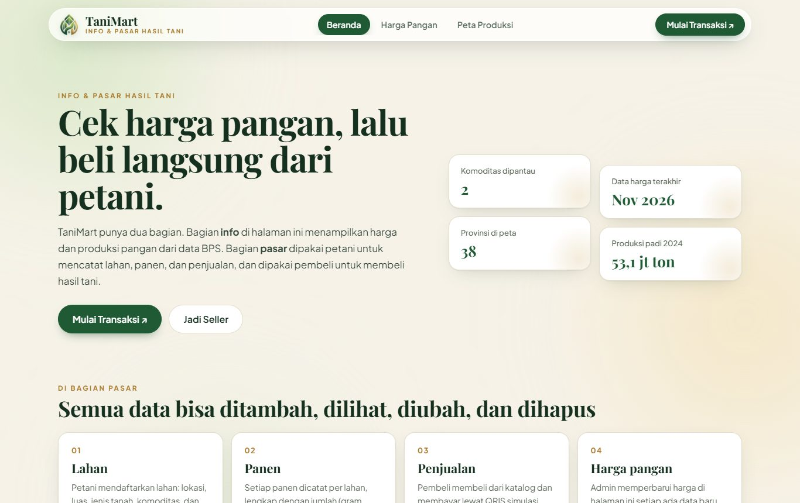
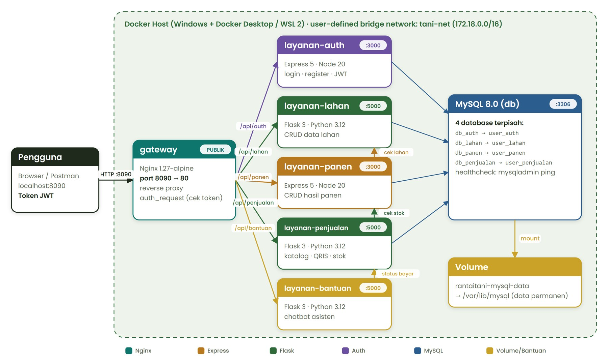
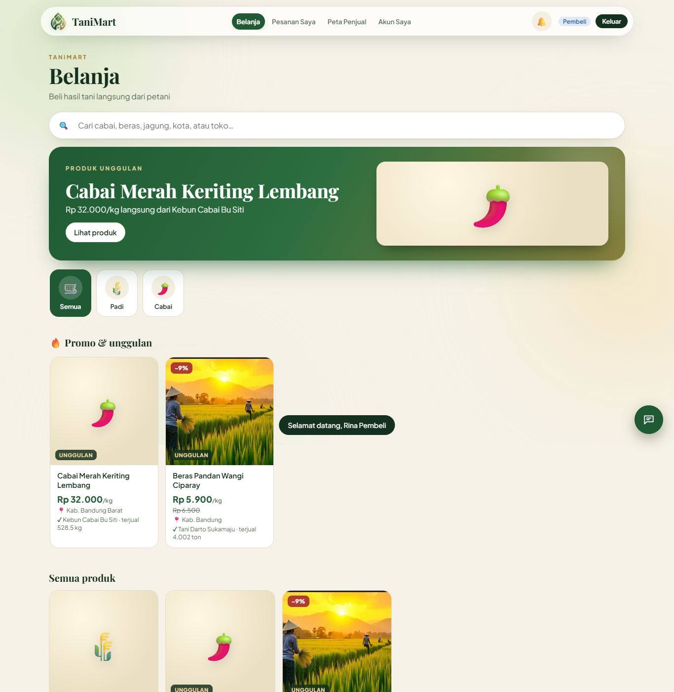
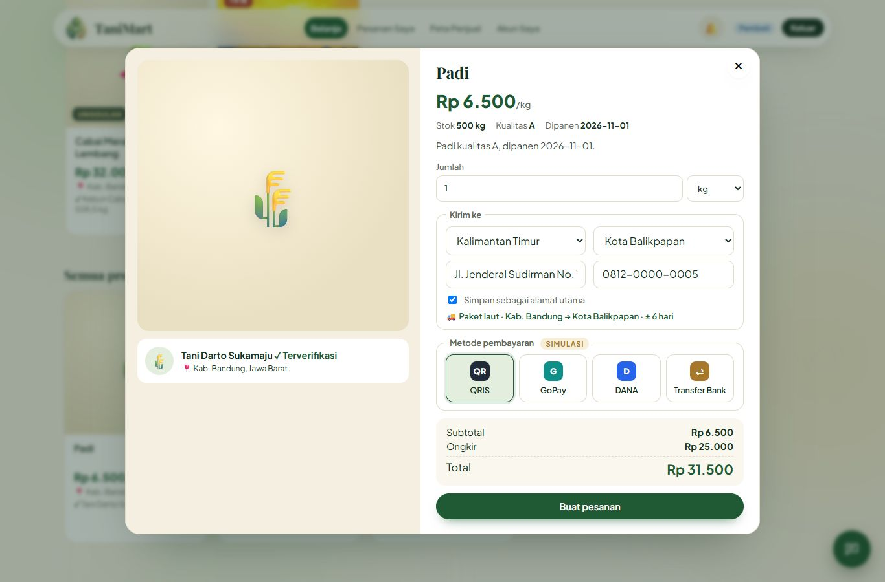
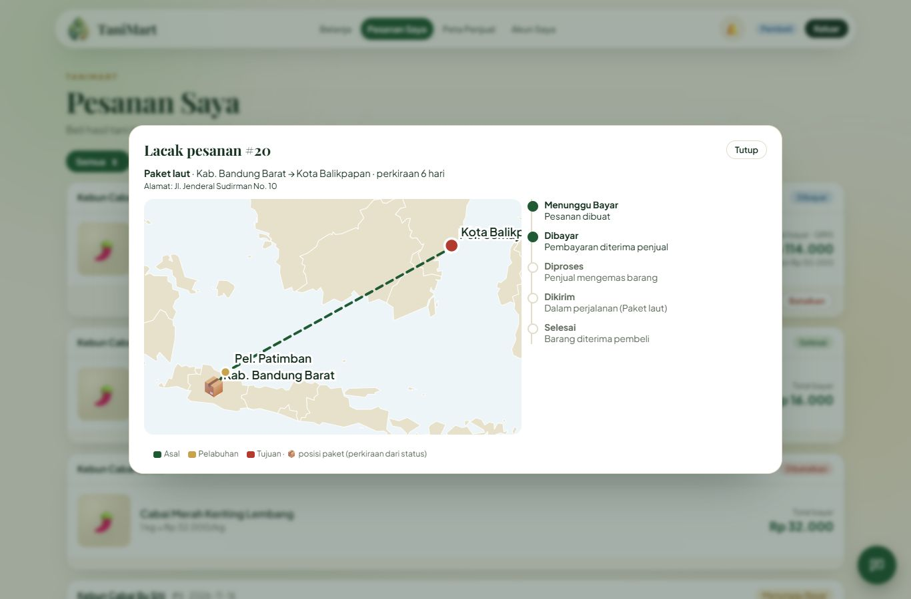
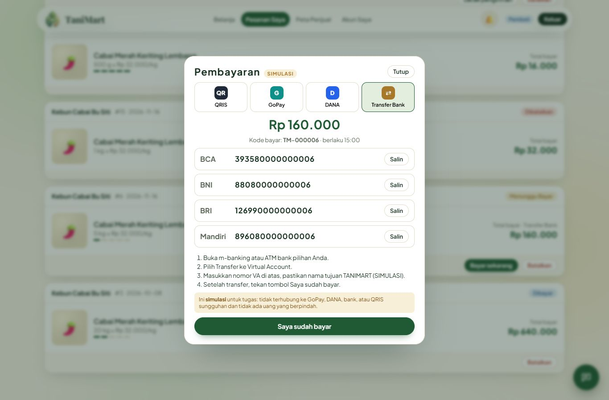
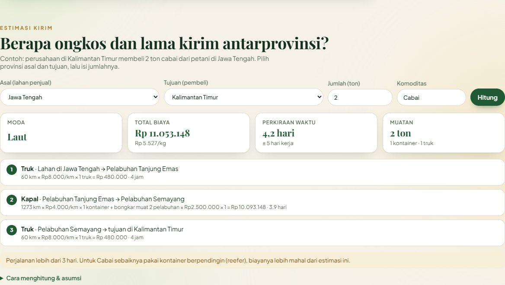
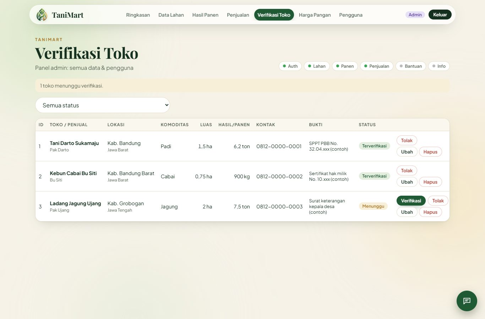
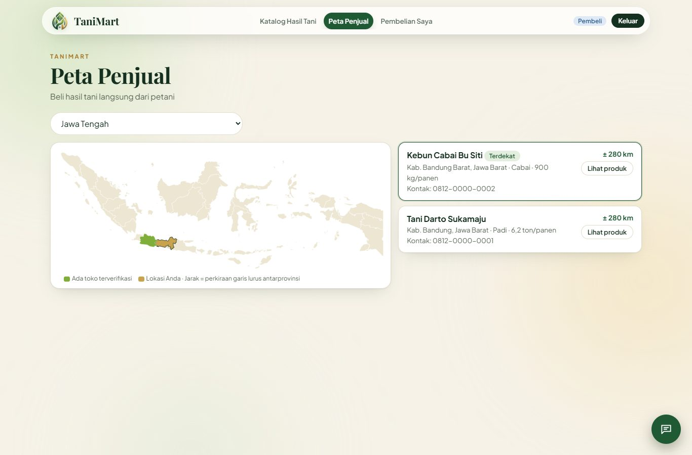
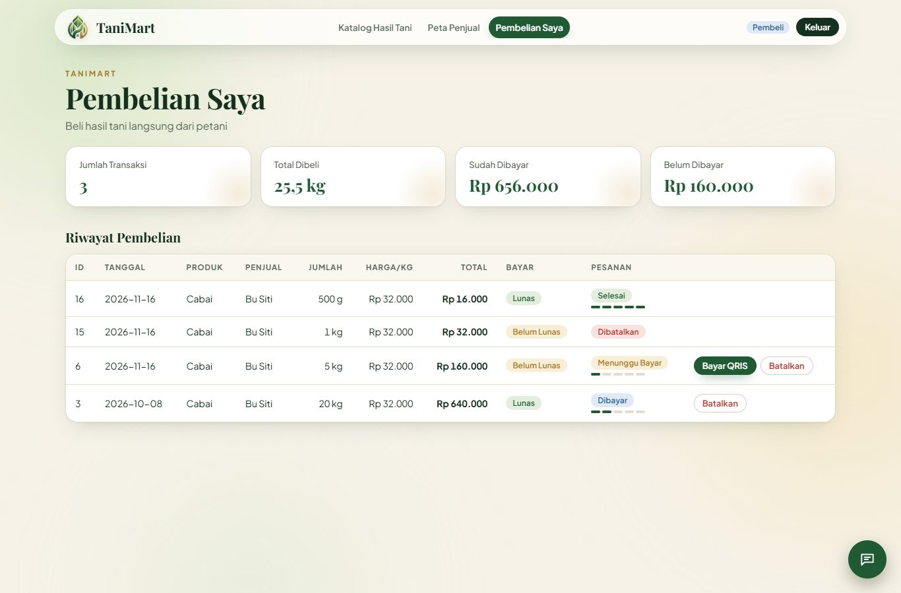

# TaniMart 🌾

**Info harga pangan dan pasar hasil tani, dibangun sebagai microservices di Docker.**
Project 1 Cloud Computing · Kelompok 10 · Kasus **Pertanian** · Platform **Microservices (Docker)** · Database **SQL (MySQL)**

TaniMart dulu bernama RantaiTani. Nama folder, container, dan repo masih memakai `rantaitani`.



## Kenapa & untuk siapa

Pencatatan lahan, panen, dan penjualan di kelompok tani sering masih terpisah, sehingga sisa stok, pembayaran, dan pendapatan sulit diketahui. Pembeli juga sulit mencari petani terdekat dan memperkirakan ongkos kirim antarpulau.

TaniMart punya dua bagian di satu alamat:

- **Info** (`/`, tanpa login): harga pangan per bulan, peta produksi per provinsi (data BPS), dan estimasi rute, biaya, serta waktu kirim antarprovinsi.
- **Pasar** (`/pasar/`, dibuka lewat tombol *Mulai Transaksi*): lahan → panen → toko → penjualan → pembayaran → pengiriman.

| Pengguna | Yang bisa dilakukan |
|---|---|
| **Penjual (petani)** | Buka toko tanpa KTP (lokasi kab/kota, luas lahan, hasil per panen, kontak), kelola lahan, unggah foto produk, pasang promo & produk unggulan, konfirmasi bayar, proses & kirim pesanan |
| **Pembeli** | Belanja ala marketplace (pencarian, kategori, promo), ongkir otomatis ke alamatnya, bayar QRIS / GoPay / DANA / transfer bank (simulasi), lacak pengiriman di peta, keranjang (checkout banyak produk sekaligus), halaman toko, ulasan & rating, batalkan sebelum diproses |
| **Admin** | Verifikasi toko, perbarui harga pangan, kelola semua data & akun, pantau status layanan |

## Arsitektur (8 container)



| Container | Teknologi | Tugas |
|---|---|---|
| `gateway` | Nginx 1.27 | Satu-satunya port publik (**8090**), menyajikan web, meneruskan `/api/*`, cek token (auth_request) |
| `layanan-auth` | Express 5 (Node.js 20) | Daftar, login (JWT), kelola pengguna, toko penjual & verifikasi |
| `layanan-lahan` | Flask 3 (Python 3.12) | CRUD lahan |
| `layanan-panen` | Express 5 (Node.js 20) | CRUD panen (stok); validasi lahan ke layanan-lahan |
| `layanan-penjualan` | Flask 3 (Python 3.12) | Katalog (hanya toko terverifikasi), jual-beli, status pesanan, QRIS simulasi |
| `layanan-bantuan` | Flask 3 (Python 3.12) | Chatbot asisten (cek status pembayaran pengguna) |
| `layanan-info` | Flask 3 (Python 3.12) | CRUD harga pangan, produksi per provinsi, estimasi rute kirim |
| `db` | MySQL 8.0 | 5 database terpisah: `db_auth`, `db_lahan`, `db_panen`, `db_penjualan`, `db_info` |

Semua container berada di network `tani-net` (bridge). Data MySQL disimpan di volume `rantaitani-mysql-data`.

## Cara menjalankan

Butuh **Docker Desktop** (atau Docker Engine + Compose v2).

```bash
git clone <url-repo-ini>
cd <nama-folder-repo>
cp .env.example .env        # Windows PowerShell: Copy-Item .env.example .env
docker compose up -d --build
```

Buka **http://localhost:8090** (info) atau **http://localhost:8090/pasar/** (pasar).

Akun contoh (dibuat otomatis saat pertama jalan):

| Peran | Username | Password |
|---|---|---|
| Admin | `admin@tanimart.test` | `admin123` |
| Penjual | `darto@tanimart.test`, `siti@tanimart.test` (toko terverifikasi), `ujang@tanimart.test` (menunggu verifikasi) | `petani123` |
| Pembeli | `rina@tanimart.test` (alamat Kota Balikpapan) | `pembeli123` |

Login bisa memakai email atau username lama (`admin`, `darto`, `rina`, ...). Lupa password memakai kode reset **simulasi** yang tampil di layar (tidak ada server email).

Perintah lain: `docker compose ps` (status), `docker compose logs -f <service>` (log), `docker compose down` (berhenti, data tetap), `docker compose down -v` (hapus beserta data).

Uji API otomatis (73 skenario, data uji dihapus lagi): `python tes/uji_api.py`

## Endpoint API (melalui gateway :8090)

| Method | URL | Fungsi |
|---|---|---|
| POST | `/api/auth/register`, `/api/auth/login` | Daftar, login (token JWT) |
| GET/POST/PUT/DELETE | `/api/auth/users[/{id}]` | Kelola pengguna (admin) |
| GET/POST/PUT/DELETE | `/api/auth/toko[/{id}]`, GET `/api/auth/toko/saya` | Toko penjual; admin mengubah status verifikasi |
| GET | `/api/auth/toko/publik` | Toko terverifikasi (tanpa kontak) |
| GET/POST/PUT/DELETE | `/api/lahan[/{id}]` | CRUD lahan |
| GET/POST/PUT/DELETE | `/api/panen[/{id}]` | CRUD panen |
| GET/POST/PUT/DELETE | `/api/penjualan[/{id}]` | CRUD penjualan / beli |
| POST | `/api/penjualan/{id}/status`, `/api/penjualan/{id}/batal` | Proses → kirim → selesai; batal hanya sebelum diproses |
| GET | `/api/penjualan/katalog`, `/api/penjualan/stok/{id}` | Katalog, sisa stok |
| GET · POST | `/api/penjualan/{id}/qris`, `/api/penjualan/{id}/sudah-bayar` | Pembayaran QRIS (simulasi) |
| GET/POST/PUT/DELETE | `/api/info/harga[/{id}]` | CRUD harga pangan (ubah: admin) |
| GET | `/api/info/publik/harga`, `/harga/terbaru`, `/produksi`, `/provinsi` | Data info publik (hanya baca) |
| GET | `/api/info/publik/estimasi?asal=&tujuan=&ton=&kota_asal=&kota_tujuan=` | Estimasi rute, ongkir, waktu kirim, titik jalur peta |
| GET | `/api/info/publik/kota[?provinsi=]` | 514 kab/kota + koordinat |
| GET/PUT · POST | `/api/auth/profil`, `/api/auth/password` | Profil & alamat kirim, ganti password |
| POST | `/api/auth/lupa`, `/api/auth/reset` | Lupa password (kode simulasi) |
| GET · POST | `/api/auth/notifikasi`, `/api/auth/notifikasi/baca` | Notifikasi |
| POST/DELETE | `/api/panen/{id}/foto` | Foto produk (JPG/PNG/WebP, maks 2 MB) |
| GET · POST · PUT · DELETE | `/api/penjualan/ulasan`, `/api/penjualan/{id}/ulasan`, `/api/penjualan/ulasan/{id}` | Ulasan & rating (setelah pesanan selesai) |
| GET | `/api/penjualan/{id}/pembayaran?metode=` | Instruksi bayar QRIS / GoPay / DANA / Transfer Bank (simulasi) |
| POST | `/api/bantuan/chat`, `/api/bantuan/publik` | Chatbot |
| GET | `/api/{layanan}/health` | Status layanan |

Kecuali login, register, dan `/publik`, kirim header `Authorization: Bearer <token>`.

## Belanja ala marketplace

| Belanja | Checkout + ongkir |
|---|---|
|  |  |
| **Lacak pengiriman** | **Bayar transfer bank (simulasi)** |
|  |  |

Ongkir dihitung dari kab/kota toko ke kab/kota pembeli. Pesanan sampai 100 kg dihitung sebagai paket ekspedisi per kg; di atas itu memakai truk, feri, atau kapal kontainer. Foto produk disimpan di volume Docker `rantaitani-uploads`.

## Alur pesanan

**Menunggu Bayar → Dibayar → Diproses → Dikirim → Selesai.** Pembeli atau penjual bisa membatalkan selama pesanan belum diproses. Pesanan yang dibatalkan tetap tercatat dan stoknya kembali ke katalog.

## Tampilan

| Estimasi kirim | Verifikasi toko (admin) |
|---|---|
|  |  |
| **Peta penjual terdekat** | **Status pesanan** |
|  |  |

## Sumber data & catatan

- Harga gabah bulanan 2024, produksi padi dan perkebunan per provinsi 2024: **BPS**.
- Harga beras medium tingkat penggilingan (17 Okt–17 Nov 2026): **Panel Harga Badan Pangan Nasional**, diekspor manual dari situsnya.
- Koordinat 514 kab/kota: [ArrayAccess/Indonesia-Postal-And-Area](https://github.com/ArrayAccess/Indonesia-Postal-And-Area) (MIT), provinsi Papua disesuaikan dengan pemekaran 2022.
- Batas provinsi: [denyherianto/indonesia-geojson-topojson-maps-with-38-provinces](https://github.com/denyherianto/indonesia-geojson-topojson-maps-with-38-provinces) (CC BY 4.0), disederhanakan.
- Estimasi kirim memakai tarif **asumsi** yang ditulis di `layanan-info/rute.py`, bukan tarif resmi ekspedisi.
- QRIS, GoPay, DANA, dan transfer bank adalah **simulasi** untuk tugas kuliah. Tidak terhubung ke bank atau e-wallet mana pun dan tidak ada uang yang berpindah. Nama metode hanya dipakai sebagai label pilihan, tanpa logo resmi.

## Struktur folder

```
├── docker-compose.yml     # orkestrasi 8 container
├── .env.example           # contoh variabel lingkungan
├── database/              # 01 init, 02 info, 03 toko, 04 status pesanan, 05 akun & notifikasi, 06 produk, 07 checkout, 08 ulasan
├── gateway/nginx.conf     # reverse proxy + pemeriksaan token
├── frontend/              # info (/), pasar (/pasar/), belanja.js/.css (marketplace), aset (font, kota.json)
├── layanan-auth/          # Express: akun & toko
├── layanan-lahan/         # Flask
├── layanan-panen/         # Express
├── layanan-penjualan/     # Flask: katalog, transaksi, pesanan
├── layanan-bantuan/       # Flask: chatbot
├── layanan-info/          # Flask: harga pangan, produksi, estimasi rute
└── tes/uji_api.py         # uji API otomatis
```
