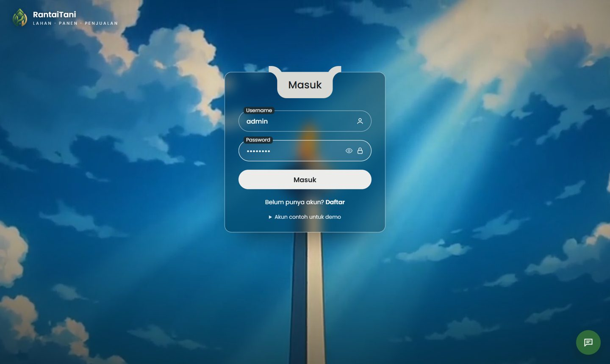
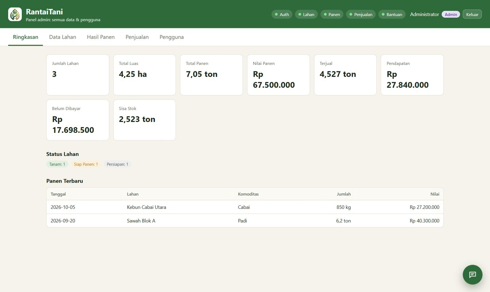
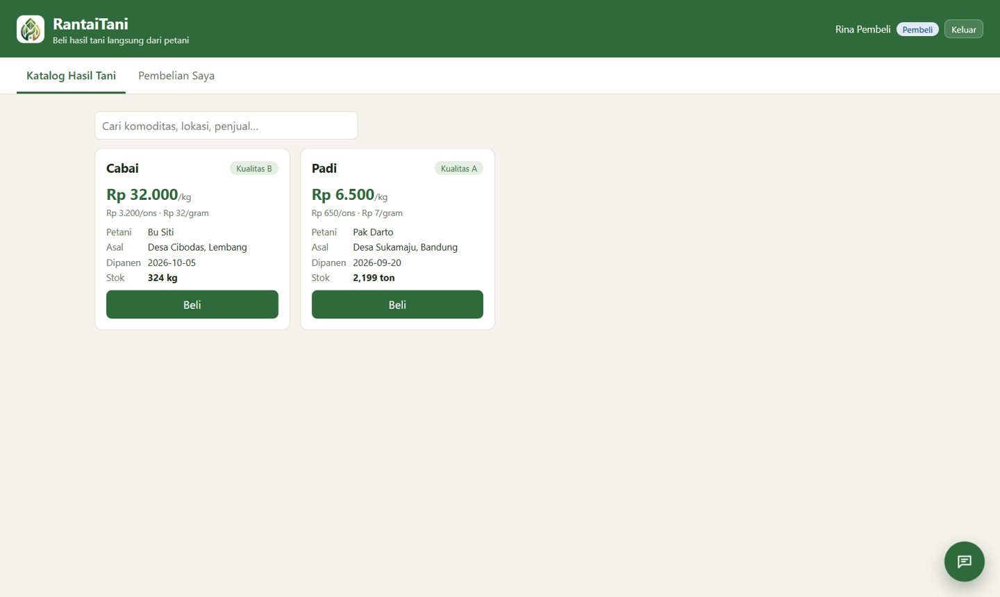
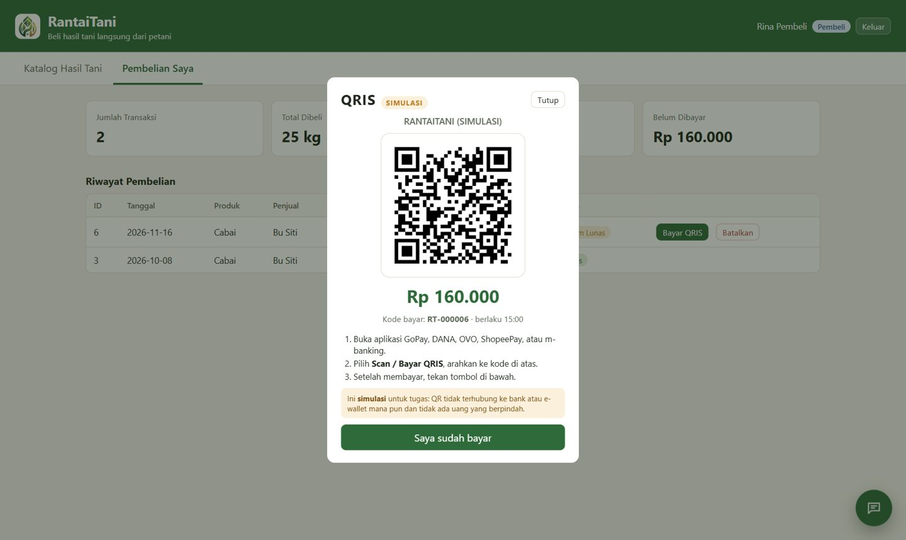
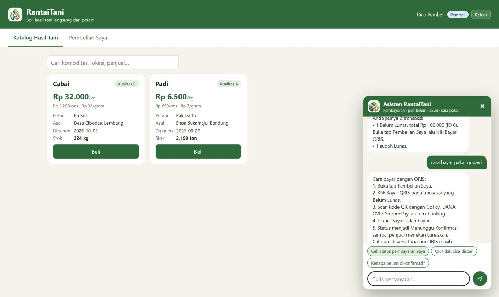

# RantaiTani 🌾

**Sistem manajemen lahan, panen, dan penjualan hasil pertanian berbasis microservices Docker.**
Project 1 Cloud Computing · Kelompok 10 · Kasus **Pertanian** · Platform **Microservices (Docker)** · Database **SQL (MySQL)**



## Kenapa & untuk siapa

Pencatatan lahan, panen, dan penjualan di kelompok tani sering masih terpisah, sehingga sisa stok, pembayaran, dan pendapatan sulit diketahui. RantaiTani mencatat seluruh rantai: **lahan → panen → penjualan → pembayaran**.

| Pengguna | Yang bisa dilakukan |
|---|---|
| **Penjual (petani)** | Kelola lahan & panen, catat penjualan, konfirmasi pembayaran, lihat pendapatan & piutang |
| **Pembeli** | Lihat katalog, beli dalam gram / ons / kg / kuintal / ton, bayar QRIS (simulasi), lihat riwayat |
| **Admin** | Awasi semua data, kelola akun pengguna, pantau status layanan |

## Arsitektur (7 container)


| Container | Teknologi | Tugas |
|---|---|---|
| `gateway` | Nginx 1.27 | Satu-satunya port publik (**8090**), menyajikan web, meneruskan `/api/*`, cek token (auth_request) |
| `layanan-auth` | Express 5 (Node.js 20) | Daftar, login (JWT), kelola pengguna |
| `layanan-lahan` | Flask 3 (Python 3.12) | CRUD lahan |
| `layanan-panen` | Express 5 (Node.js 20) | CRUD panen (stok); validasi lahan ke layanan-lahan |
| `layanan-penjualan` | Flask 3 (Python 3.12) | Katalog, jual-beli, cek stok ke layanan-panen, QRIS simulasi |
| `layanan-bantuan` | Flask 3 (Python 3.12) | Chatbot asisten (cek status pembayaran pengguna) |
| `db` | MySQL 8.0 | 4 database terpisah: `db_auth`, `db_lahan`, `db_panen`, `db_penjualan` |

Semua container berada di network `tani-net` (bridge). Data MySQL disimpan di volume `rantaitani-mysql-data`.

## Cara menjalankan

Butuh **Docker Desktop** (atau Docker Engine + Compose v2).

```bash
git clone <url-repo-ini>
cd <nama-folder-repo>
cp .env.example .env        # Windows PowerShell: Copy-Item .env.example .env
docker compose up -d --build
```

Buka **http://localhost:8090**. Dari perangkat lain di jaringan yang sama: `http://<IP-laptop>:8090`.

Akun contoh (dibuat otomatis saat pertama jalan):

| Peran | Username | Password |
|---|---|---|
| Admin | `admin` | `admin123` |
| Penjual | `darto`, `siti`, `ujang` | `petani123` |
| Pembeli | `rina` | `pembeli123` |

Perintah lain: `docker compose ps` (status), `docker compose logs -f <service>` (log), `docker compose down` (berhenti, data tetap), `docker compose down -v` (hapus beserta data).

## Endpoint API (melalui gateway :8090)

| Method | URL | Fungsi |
|---|---|---|
| POST | `/api/auth/register`, `/api/auth/login` | Daftar, login (token JWT) |
| GET/POST/PUT/DELETE | `/api/auth/users[/{id}]` | Kelola pengguna (admin) |
| GET/POST/PUT/DELETE | `/api/lahan[/{id}]` | CRUD lahan |
| GET/POST/PUT/DELETE | `/api/panen[/{id}]` | CRUD panen |
| GET/POST/PUT/DELETE | `/api/penjualan[/{id}]` | CRUD penjualan / beli / batal |
| GET | `/api/penjualan/katalog`, `/api/penjualan/stok/{id}` | Katalog, sisa stok |
| GET · POST | `/api/penjualan/{id}/qris`, `/api/penjualan/{id}/sudah-bayar` | Pembayaran QRIS (simulasi) |
| POST | `/api/bantuan/chat`, `/api/bantuan/publik` | Chatbot |
| GET | `/api/{layanan}/health` | Status layanan |

Selain login/register, kirim header `Authorization: Bearer <token>`.

## Tampilan

| Admin | Katalog pembeli |
|---|---|
|  |  |
| **Bayar QRIS (simulasi)** | **Chatbot** |
|  |  |

> Catatan: QRIS di proyek ini adalah **simulasi** untuk tugas kuliah; tidak terhubung ke bank atau e-wallet dan tidak ada uang yang berpindah.

## Struktur folder

```
├── docker-compose.yml     # orkestrasi 7 container
├── .env.example           # contoh variabel lingkungan
├── database/init.sql      # 4 database, user per layanan, tabel, data awal
├── gateway/nginx.conf     # reverse proxy + pemeriksaan token
├── frontend/              # HTML, CSS, JS, aset (logo, video login)
├── layanan-auth/          # Express
├── layanan-lahan/         # Flask
├── layanan-panen/         # Express
├── layanan-penjualan/     # Flask
└── layanan-bantuan/       # Flask (chatbot)
```
